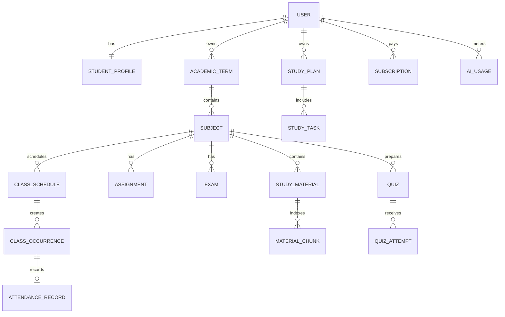

# ExamPilot AI — Architecture and first release contract

## Release statuses

| Milestone | Scope | Status |
| --- | --- | --- |
| M1 | Native Android premium preview, four-tab mobile app, focus timer, attendance calculator, FastAPI health checks | In progress |
| M2 | Real signup/login, profiles, terms, subjects, migrations | Planned |
| M3 | Timetable, attendance, exams, assignments, grade calculations | Planned |
| M4 | Document ingestion, grounded AI study tools and quizzes | Planned |
| M5 | Semester Intelligence, subscription entitlements, security/public beta | Planned |

## Domain ERD (target, simplified)

**Primary client:** Android application in `mobile/`, built with React Native, Expo Router and TypeScript. The `frontend/` Vite project is an optional visual design reference, not the product to publish. Mobile screens currently use a clearly labelled session-only demo store. No user information is sent to the backend.

All private entities must enforce ownership and user-scoping on the API and in every query. UUID identifiers, timezone-aware timestamps, migrations and constrained statuses will be used.

## HTTP endpoints in milestone 1

- `GET /health/live`: process liveness. Always returns `{ "status": "ok", "service": "exampilot-api" }` if running.
- `GET /health/ready`: checks database connectivity. Returns `200` ready, or `503` not_ready, with no database credentials exposed.
- `GET /docs`: development-only OpenAPI (disabled in production environment setting).

## First persistent milestones (planned APIs)

- Auth: `POST /api/v1/auth/signup`, `POST /api/v1/auth/login`, `POST /api/v1/auth/logout`, `GET /api/v1/me`.
- Academics: `/api/v1/terms`, `/api/v1/subjects`, `/api/v1/class-schedules`, `/api/v1/attendance`, `/api/v1/assignments`, `/api/v1/exams`, `/api/v1/grades`.
- Study: `/api/v1/materials`, `/api/v1/quizzes`, `/api/v1/study-plan`, `/api/v1/progress`.
- Billing: `GET /api/v1/subscription`, `POST /api/v1/billing/webhook`.

These planned routes are **not** live in milestone 1.

## Correctness constraints

- Attendance is based on actual eligible class occurrences and editable institution rules, not just recurring schedule rows.
- `attendance = attended / eligible_total` with a clearly defined rule for excused/cancelled classes.
- For target fraction `p`, attended `A` of eligible `T`, required consecutive attendances: `max(0, ceil((p*T-A)/(1-p)))` if `0 < p < 1`.
- For fixed `A`, `T`, maximum future absent classes without attending more: `max(0, floor(A/p - T))` when `A/T >= p`. This is informational and not permission to miss class.
- Weighted CGPA/SGPA must use the configured institution grade mapping, not a universal hard-coded table.
- Only the backend can confirm successful subscription events through signed and idempotent webhooks.

## Security and release gate

Production requires verified authentication, per-record authorization, CSRF controls where relevant, secure cookies, secret management, file validation, private storage, deletion policy, AI cost ceilings, error tracking, tested migration and backup recovery, and payment sandbox verification. M1 is for local review, **not public release**.

